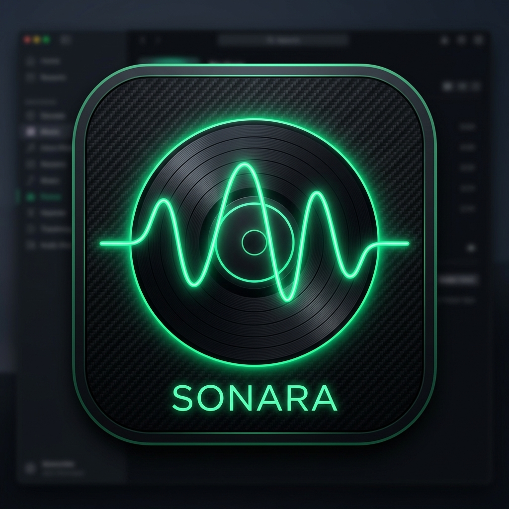
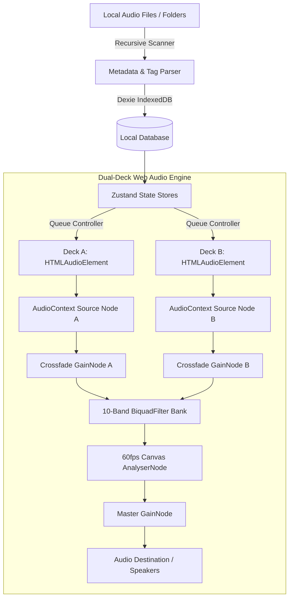

<div align="center">

  

  # Sonara

  ### The Spotify-Grade, 100% Offline & Privacy-First Local Music Player

  [](https://github.com)
  [](https://github.com)
  [](LICENSE)
  [](https://github.com)
  [](https://github.com)

  <br/>

  <p align="center">
    <b>Sonara</b> brings the exact visual elegance, fluid 3-column layout, and refined audio experience of the Spotify desktop client directly to your local audio library. Zero subscriptions, zero telemetry, bit-perfect local playback, and completely standalone.
  </p>

  <p align="center">
    <a href="https://github.com/releases/latest">
      
    </a>
  </p>

</div>

---

## 🌟 Highlights & Features

### 🎧 Studio-Grade Dual-Deck DSP Audio Engine
- **True Gapless & Crossfading**: Dual synchronized audio deck graph with customizable crossfade (0–12 seconds).
- **10-Band Graphic Equalizer**: Interactive SVG frequency curve spanning 31 Hz to 16 kHz with ±12 dB gains and acoustic presets (*Bass Booster, Acoustic, Rock, Vocal Booster, Classical, Flat*).
- **60fps Real-Time Visualizer**: Frequency spectrum and waveform visualizer rendered on HTML5 Canvas using an active `AnalyserNode` (2048 FFT).

### 📁 Smart Folder & Library Import
- **Recursive Directory Importer**: Import your full music folders or nested artist/album directory trees in seconds.
- **Folder-to-Playlist Auto-Sync**: Automatically converts imported folders into synced playlists in your sidebar.
- **Smart Duplicate & Re-linking Engine**: Bit-identical cryptographic fingerprinting re-links loose tracks to their parent folders without metadata loss.
- **Drag & Drop**: Seamlessly drag audio files or entire folders straight into Sonara.

### 🤖 100% Offline AI Recommendations
- **Daily Mixes 1–6**: Graph-based clustering creates daily mixes based on genres, eras, and listening affinity—computed entirely on your machine.
- **"Picked for You"**: Context-aware recommendations explaining *why* a song was suggested (e.g. *"Because you listened to Pink Floyd yesterday"*).
- **Circadian Rhythm & Stats**: Visual breakdown of your hourly listening rhythm, top genres, and play streaks.

### 🎤 Synchronized LRC Lyrics
- **Real-Time Auto-Scroll**: Ultra-smooth synchronized lyric tracking with active glowing highlights.
- **Click-to-Seek & Offset Tuning**: Click any lyric line to jump directly to that point in the song; tune millisecond offset on the fly.
- **Built-in Editor**: Rectify, format, or paste `.lrc` text directly inside the app.

---

## 🖼️ Architecture & DSP Pipeline



---

## ⚡ Quick Download & Installation

### Option 1: Standalone Windows Installer (Recommended)
1. Head over to the [**Releases**](https://github.com/releases/latest) section.
2. Download **`Sonara Setup 1.0.0.exe`**.
3. Run the setup installer and launch **Sonara** from your Desktop or Start Menu.

### Option 2: Run from Source

#### Prerequisites
- [Node.js](https://nodejs.org/) (version 20 or higher)
- npm 10+

```bash
# 1. Clone the repository
git clone https://github.com/<your-username>/sonara.git
cd sonara

# 2. Install dependencies
npm install

# 3. Launch in development mode
npm run dev

# 4. Or launch the native Electron desktop application
npm run build && npm run build:electron && npx electron .
```

#### Build Your Own Windows Executable (.exe)
```bash
npm run dist
```
The installer will be generated in `dist-release/Sonara Setup 1.0.0.exe`.

---

## ⌨️ Keyboard Shortcuts

| Shortcut | Action |
|:---|:---|
| <kbd>Space</kbd> | Play / Pause |
| <kbd>Ctrl</kbd> + <kbd>→</kbd> | Next Track |
| <kbd>Ctrl</kbd> + <kbd>←</kbd> | Previous Track |
| <kbd>Shift</kbd> + <kbd>→</kbd> | Seek Forward 5s |
| <kbd>Shift</kbd> + <kbd>←</kbd> | Seek Backward 5s |
| <kbd>Ctrl</kbd> + <kbd>↑</kbd> | Volume Up (+5%) |
| <kbd>Ctrl</kbd> + <kbd>↓</kbd> | Volume Down (-5%) |
| <kbd>M</kbd> | Mute / Unmute |
| <kbd>S</kbd> | Toggle Shuffle |
| <kbd>R</kbd> | Cycle Repeat Mode (Off / All / One) |
| <kbd>L</kbd> | Like / Favorite Current Track |
| <kbd>Ctrl</kbd> + <kbd>K</kbd> | Open Global Command Palette |
| <kbd>E</kbd> | Open 10-Band Graphic Equalizer |
| <kbd>Y</kbd> | Toggle Synchronized Lyrics |
| <kbd>Q</kbd> | Toggle Playback Queue |
| <kbd>F</kbd> | Enter Fullscreen Player Mode |

---

## 🎼 Supported Formats

Sonara natively decodes and plays all standard audio formats offline:

| Format | Extension | Tag Extraction | Lossless |
|:---|:---:|:---:|:---:|
| **MP3** | `.mp3` | ID3v1, ID3v2.3, ID3v2.4 | Standard |
| **FLAC** | `.flac` | Vorbis Comment, Embedded Artwork | Bit-Perfect Lossless |
| **WAV** | `.wav` | RIFF INFO, ID3 Chunk | Bit-Perfect Lossless |
| **AAC / M4A** | `.m4a`, `.aac`, `.mp4` | MP4 iTunes Metadata | High Efficiency |
| **OGG / Opus** | `.ogg`, `.opus`, `.oga` | Vorbis Comments | Modern Low-Latency |
| **WebM** | `.webm` | Matroska / WebM Tags | Web Standard |
| **AIFF / APE / WV** | `.aiff`, `.ape`, `.wv` | Native Tags | Audiophile Lossless |

---

## 🔒 Privacy & Local-First Philosophy

Sonara is built from the ground up on the following privacy principles:
- **Zero Cloud Accounts**: No logins, email verification, or registration walls.
- **Zero Telemetry**: No tracking beacons, analytics, or pingbacks.
- **Local Database**: All library indexes, play history, playlists, and settings reside strictly in your local client database (`IndexedDB`).
- **Cryptographic Fingerprints**: Tracks are fingerprinted based on audio file attributes, allowing full metadata preservation even when renaming or moving library drives.

---

## 🛠️ Tech Stack

- **Framework**: React 19, TypeScript 5.9
- **Bundler & Tooling**: Vite 8, Rolldown
- **Desktop Shell**: Electron 45, Electron Builder 26
- **Styling**: Tailwind CSS 4, Spotify Design Tokens (`tokens.css`)
- **State Management**: Zustand
- **Database**: Dexie.js (IndexedDB)
- **Audio & DSP**: Web Audio API, HTML5 Media Elements
- **Tag Parsing**: Music-Metadata (optimized chunk streaming)
- **Testing**: Vitest (62 unit tests passing)

---

## 📄 License

This project is open-source and released under the **[MIT License](LICENSE)**.

---

<div align="center">
  <sub>Created with ❤️ by <b>zohair</b></sub>
</div>
